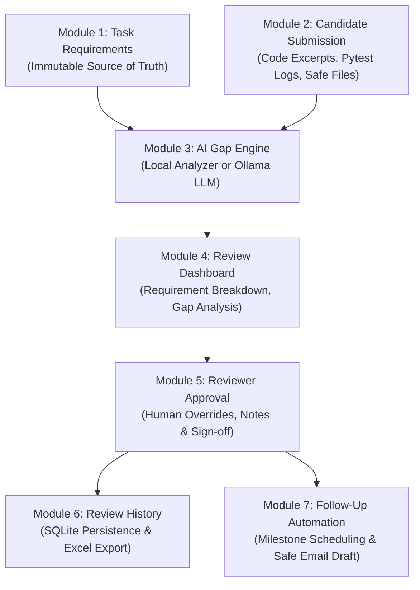

# AI-Powered Task Review Automation System

An automated, human-in-the-loop evaluation and follow-up platform built in Python and Streamlit. This system assists technical reviewers in evaluating candidate project submissions against original requirements, identifying functional gaps, generating actionable feedback, and managing milestone follow-up reviews.

---

## 🌟 Key Highlights

- **100% Free & Local-First**: No paid API keys required. Ships with a deterministic **Local Smart Analyzer** out of the box and seamlessly supports local LLMs via **Ollama** (e.g., Llama 3, Mistral, Qwen).
- **Evidence vs. Claims Verification**: Distinguishes verified implementation evidence (actual code snippets, passing pytest logs) from candidate text assertions. Unverified claims are marked as `Needs Verification` rather than falsely marked complete.
- **Strict Human-in-the-Loop**: AI functions strictly as an assistive analyst. Final approval, hiring decisions, and requirement overrides remain 100% under human reviewer control.
- **Safe Inspection**: Uploaded candidate files (`.py`, `.js`, `.json`, `.sql`, etc.) are inspected statically for text and syntax signals. **Zero uploaded code is ever executed**.
- **Audit-Ready History & Excel Export**: Persists tasks, submissions, findings, and reviews in SQLite with parameterized SQL. Generates multi-tab `.xlsx` audit reports using Pandas and OpenPyXL.

---

## 🏗️ Architecture & Modules

The application is structured into 7 core functional modules:



### 1. Module 1: Task Requirements (Source of Truth)
- Define task title, description, expected deliverables, and acceptance criteria.
- Breakdown tasks into individual requirement items (`REQ-1`, `REQ-2`, etc.) with assigned priorities (`High`, `Medium`, `Low`).
- Preserves the original requirements immutably to prevent artificial drift.

### 2. Module 2: Candidate Submission
- Records candidate metadata (`CAND-ID`), submission title, and description of completed work.
- Accepts concrete evidence: code snippets, terminal execution outputs (e.g. `pytest` logs), and repository URLs.
- Safe file uploader supporting `.py`, `.js`, `.ts`, `.json`, `.txt`, `.md`, `.sql`, `.pdf`, `.png` (up to 5MB) with path sanitization and non-executing preview extraction.

### 3. Module 3: AI-Powered Review & Gap Analysis
For every requirement, the engine evaluates 8 standardized dimensions:
1. **Original Requirement**
2. **Expected Result**
3. **Evidence Found**
4. **Status**: `Completed`, `Partially Completed`, `Missing`, or `Needs Verification`
5. **Identified Gap**
6. **Recommended Correction**
7. **Priority**: `High`, `Medium`, or `Low`
8. **Suggested Next Action**

### 4. Module 4: Review Dashboard
- Real-time status breakdown metrics (Total, Completed, Partial, Needs Verification, Missing).
- Interactive visual chart and detailed finding cards with color-coded badges.
- Objective summary avoiding misleading completion scores when evidence is pending verification.

### 5. Module 5: Reviewer Feedback & Approval
- Reviewers inspect AI findings, edit gaps and corrections, and override status flags where necessary.
- Per-finding approval checkboxes and detailed rationale fields.
- Official session status: `Draft`, `Approved`, or `Needs Work`.
- Persists all data transactionally to SQLite using parameterized SQL queries.

### 6. Module 6: Review History & Excel Export
- Search and reopen historical review sessions.
- Download a complete 3-sheet Excel audit workbook (`.xlsx`) containing:
  - *Overview Tab*: Candidate information, reviewer name, status summary.
  - *Detailed Findings Tab*: 8-field analysis for every requirement with reviewer notes.
  - *Action Plan Tab*: Filtered list of outstanding requirements with required corrections.

### 7. Module 7: Follow-Up Automation & Real Email Dispatch
- Validate and schedule the next milestone review date (strictly in the future).
- Auto-generate an action checklist for the candidate.
- Prepare a formatted email reminder notification with live draft preview.
- **Real Gmail SMTP Dispatch**: Dispatches authentic follow-up reminder emails via Gmail SMTP (`smtp.gmail.com:587`) using environment credentials.
- **Reviewer Confirmation Guard**: Requires explicit checkbox confirmation before sending.
- **Placeholder Address Rejection**: Blocks invalid placeholder recipients such as `cand-1001@example.com` or `@test.com`.
- **Zero Credential Storage**: Passwords are never saved to SQLite, hardcoded, or displayed in the UI.

---

## 💻 Tech Stack

- **Application Logic**: Python 3.11+
- **Web Interface**: Streamlit
- **Data & Spreadsheet Export**: Pandas, OpenPyXL
- **Database**: SQLite (`sqlite3`) with parameterized queries and foreign keys
- **AI Engine**: Local Deterministic Rule & Token Analyzer (built-in, zero dependencies) + Ollama Local LLM connector

---

## 🚀 Windows Installation and Execution

### Prerequisites
- Python 3.10+ installed on Windows.

### 1. Open Terminal or PowerShell
Open PowerShell or Command Prompt and navigate to the project directory:
```powershell
cd C:\Users\dell\.gemini\antigravity\scratch\task-review-automation
```

### 2. Install Required Packages
```powershell
python -m pip install -r requirements.txt
```

### 3. Launch the Web Application
Run the Streamlit server:
```powershell
python -m streamlit run app.py
```
*Alternatively, simply double-click `run_app.bat` on Windows.*

The application will open automatically in your browser at `http://localhost:8501`.

---

## 📧 Configuring Real Gmail SMTP Notifications Safely

The system allows reviewers to send real follow-up reminder emails directly to candidates using Gmail SMTP (`smtp.gmail.com:587`).

### 1. Generate a Gmail App Password
Google requires a 16-character **App Password** (not your regular account password):
1. Go to your [Google Account Security Settings](https://myaccount.google.com/security).
2. Ensure **2-Step Verification** is turned ON.
3. Search for **App Passwords** (or visit [myaccount.google.com/apppasswords](https://myaccount.google.com/apppasswords)).
4. Enter an app name (e.g. `TaskReviewAutomation`) and click **Create**.
5. Copy the generated 16-character code (e.g., `abcd efgh ijkl mnop`).

### 2. Configure Environment Variables on Windows

You have two safe methods to provide credentials:

#### Option A: Using a `.env` File (Recommended)
Copy `.env.example` to `.env` in the project root:
```ini
GMAIL_SENDER_EMAIL=your_actual_email@gmail.com
GMAIL_APP_PASSWORD=abcd efgh ijkl mnop
SMTP_SERVER=smtp.gmail.com
SMTP_PORT=587
```
*(The `.env` file is automatically ignored by `.gitignore` so your secret is never pushed to version control).*

#### Option B: In PowerShell Session
Before running the application:
```powershell
$env:GMAIL_SENDER_EMAIL = "your_actual_email@gmail.com"
$env:GMAIL_APP_PASSWORD = "abcd efgh ijkl mnop"
```

#### Option C: In Command Prompt (cmd.exe)
```cmd
set GMAIL_SENDER_EMAIL=your_actual_email@gmail.com
set GMAIL_APP_PASSWORD=abcd efgh ijkl mnop
```

### 3. Sending an Email in the Web Application
1. Navigate to **📅 Next Review & Follow-Up (Module 7)** in the sidebar.
2. Select the review session and set the next milestone date.
3. Review the auto-generated **Email Content Preview**.
4. Enter the candidate's real email address in **Candidate Real Email Address**.
   - *Note: Placeholder addresses (e.g., `cand-1001@example.com` or `@test.com`) will be rejected.*
5. Check the confirmation box: `✅ I confirm that I have reviewed the draft and approve sending this email.`
6. Click **📤 Send Automated Reminder Notification**.
7. The system connects to `smtp.gmail.com:587` over TLS and displays a success notification with balloons once accepted by the server.

---

## 🧪 Running Automated Tests

Run the test suite and end-to-end workflow verification:

```powershell
# Run unit & integration tests with pytest (includes mocked SMTP tests)
python -m pytest tests/test_core.py -v

# Run the complete automated end-to-end workflow demonstration
python tests/test_end_to_end_flow.py
```
*Or double-click `run_tests.bat`.*

### Test Suite Coverage (12 Automated Tests)
- `test_models_and_final_status`: Validates data structures and reviewer override resolution.
- `test_file_validation_security`: Tests file type restrictions, size limits, path sanitization, and safe preview extraction.
- `test_database_crud_and_seed`: Tests SQLite schema initialization, cascading foreign keys, CRUD transactions, and sample seeding.
- `test_ai_engine_distinguishes_evidence_from_claims`: Tests accurate detection of `Completed` (verified code), `Partially Completed` (criteria mismatch), `Needs Verification` (claims without code), and `Missing`.
- `test_ollama_graceful_fallback`: Tests automatic fallback to the local analyzer when Ollama is offline.
- `test_followup_and_date_validation`: Tests date validation, follow-up checklist creation, and simulated notification dispatch.
- `test_excel_export`: Tests multi-tab `.xlsx` workbook generation.
- `test_recipient_email_validation`: Verifies syntax validation and strict rejection of placeholder addresses (`cand-1001@example.com`, `@test.com`, `@sample.com`).
- `test_send_followup_email_safety_guards`: Verifies rejection if unconfirmed by reviewer, if recipient is placeholder, or if credentials are missing.
- `test_send_followup_email_mocked_smtp_success`: Tests complete SMTP handshake (STARTTLS, login, and send_message) using mocked SMTP so no real emails are sent during testing.
- `test_send_followup_email_mocked_smtp_auth_error`: Verifies graceful error reporting without leaking secret passwords.
- `test_send_followup_email_mocked_smtp_network_error`: Verifies network timeout and connection error handling.

---

## 🛡️ Reliability and Security Guardrails

1. **Zero Automatic Code Execution**: Candidate scripts are read as plain text for pattern matching; they are never imported or executed.
2. **Path Sanitization**: Prevents directory traversal attacks via `sanitize_filename`.
3. **SQL Injection Defense**: 100% of database queries utilize parameterized SQL placeholders (`?`).
4. **Data Privacy**: The database file (`reviews.db`) and uploaded files are excluded from version control via `.gitignore`.
5. **Safe Email Dispatch**: Outbound emails require reviewer confirmation, reject placeholder addresses, and never expose or store email passwords in code or database.
6. **Isolated Test Automation**: Automated unit and end-to-end tests use `unittest.mock` for SMTP so tests never send real emails.
